# Inventory & Sales Management System (UTS Pemrograman Web 2)

Aplikasi Laravel 12 untuk mengelola master data, pembelian (stok bertambah), penjualan (stok berkurang), dan pengguna dengan tiga peran: owner (pemilik), staff/admin toko, dan customer (pembeli).

## 1. Project overview
Toko mengelola kategori, produk, dan pemasok; mencatat pembelian dan penjualan dengan banyak item per transaksi; stok berubah otomatis dan aman (database transaction, tanpa overselling). Owner mengelola data master dan pengguna serta memutuskan pembatalan; staff/admin mencatat pembelian dan penjualan. Pembeli (customer) bisa mendaftar sendiri, memilih produk di katalog, membuat pesanan lewat keranjang, dan mengajukan pembatalan yang diputuskan owner.

## 2. Requirements
- PHP 8.2 atau lebih baru (ekstensi: mbstring, openssl, pdo_mysql, zip; pdo_sqlite untuk menjalankan test)
- Composer 2
- MySQL / MariaDB (contoh: XAMPP)
- Tidak memerlukan Node.js (tampilan memakai satu file CSS statis di `public/css/app.css`, jadi `npm install` dan `npm run build` tidak diperlukan)

## 3. Installation
```
git clone <repository-url>
cd inventory-sales
composer install
copy .env.example .env      (Linux/Mac: cp .env.example .env)
php artisan key:generate
```

## 4. Environment setup
1. Buat database kosong bernama `inventory_sales` (phpMyAdmin atau `CREATE DATABASE inventory_sales;`).
2. Buka `.env`, pastikan `DB_DATABASE=inventory_sales`, `DB_USERNAME` dan `DB_PASSWORD` sesuai MySQL kamu. File `.env` tidak boleh di-commit.

## 5. Migration & seeding
```
php artisan migrate:fresh --seed
php artisan serve
```
Buka http://127.0.0.1:8000. Seeder membuat 3 akun demo, 6 kategori, 3 pemasok, 24 produk (SKU unik), 4 pembelian, 5 penjualan kasir, dan 2 pesanan customer (satu di antaranya sudah meminta pembatalan). Transaksi contoh disebar ke 7 hari terakhir supaya grafik dashboard terisi. Untuk menjalankan test: `php artisan test`.

## 6. Demo account
| Peran | Email | Password |
|---|---|---|
| Owner | owner@tokosaya.com | owner12345 |
| Staff/Admin | staff@tokosaya.com | staff12345 |
| Customer | pembeli@tokosaya.com | customer12345 |

(Hanya untuk demo lokal. Bukan kredensial pribadi.)

## 7. Features
- Login/logout dengan tiga peran (dijaga di server lewat Gate + middleware `can:`):

  | Hak akses | Owner | Staff/Admin | Customer |
  |---|:-:|:-:|:-:|
  | Dashboard khusus peran | grafik + keputusan | tugas harian | - |
  | CRUD kategori, produk, pemasok | ✅ | lihat produk saja | - |
  | Pembelian (stok masuk) dan penjualan | ✅ | ✅ | - |
  | Melihat transaksi | semua | milik sendiri | pesanan sendiri |
  | Membatalkan transaksi / memutuskan pembatalan | ✅ | - | hanya mengajukan |
  | Kelola pengguna | ✅ | - | - |
  | Katalog, keranjang, pesanan saya | - | - | ✅ |

- Pembelian: banyak item, stok naik, bisa dibatalkan (ditolak bila stok sudah terjual).
- Penjualan: banyak item, stok turun, tidak boleh melebihi stok, bisa dibatalkan (stok kembali).
- Total dan harga dihitung **server** dari database, bukan dari input form.
- Produk yang sudah dipakai transaksi tidak bisa dihapus.
- Dashboard berbeda untuk tiap peran. Dashboard owner: ringkasan angka seluruh toko, **grafik penjualan vs pembelian 7 hari terakhir** (berubah otomatis mengikuti transaksi, dibatalkan tidak dihitung), **produk terlaris**, dan stok rendah. Dashboard staff: hanya angka, grafik, dan transaksi miliknya sendiri.
- Halaman error yang rapi untuk 403, 404, 419, dan 500.
- Pencarian, filter, dan pagination di produk, pembelian, penjualan.
- Manajemen pengguna (owner): tambah/ubah/hapus; owner tidak bisa menghapus dirinya atau mengubah perannya sendiri; pengguna yang punya transaksi tidak bisa dihapus.
- Staff hanya melihat transaksi miliknya sendiri.
- **Customer**: daftar sendiri (`/register`, peran selalu customer), katalog belanja dengan pencarian dan filter kategori, keranjang (disimpan di session, harga dibaca dari database), checkout memakai `SaleService` yang sama dengan kasir (transaction, kunci stok, tanpa overselling), halaman *Pesanan Saya* (hanya pesanan miliknya).
- **Pembatalan oleh customer**: customer mengajukan pembatalan dengan alasan; stok belum berubah. Owner melihat peringatan di dashboard lalu menyetujui (stok kembali) atau menolak (pesanan tetap berlaku). Staff tidak bisa memutuskan.
- Customer tidak bisa membuka halaman back office (produk, pembelian, penjualan, pengguna): server menjawab 403.

## 8. Known limitations
- Pembelian tidak mengubah harga beli produk secara otomatis.
- Tidak ada edit transaksi; koreksi dilakukan dengan membatalkan lalu membuat ulang.
- Tidak ada laporan ekspor (PDF/Excel).
- Tidak ada peramalan (forecasting) AI; yang ada daftar produk terlaris dari data penjualan.
- Tampilan memakai CSS sendiri (tanpa Vite/Tailwind).

## ERD
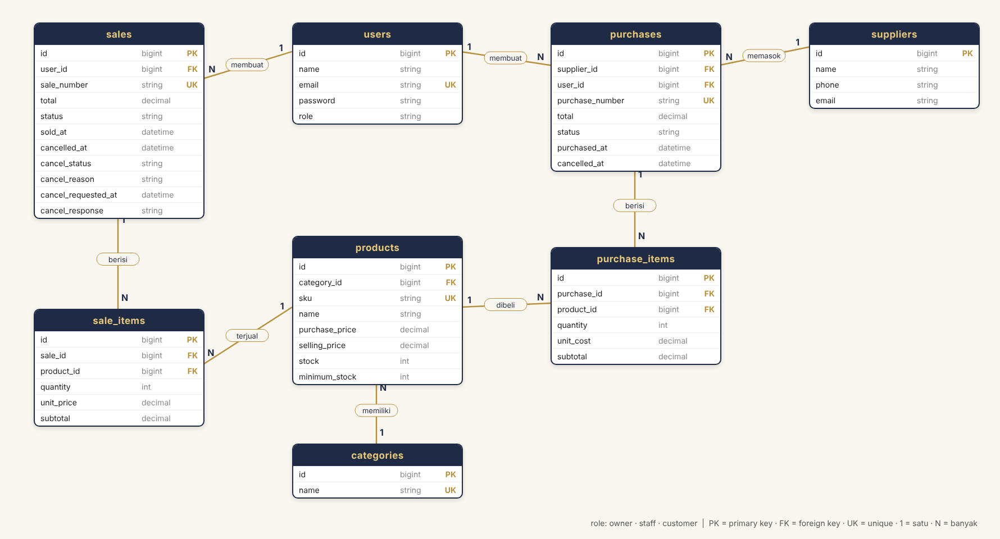

## Relasi Eloquent
- Category hasMany Product; Product belongsTo Category
- Supplier hasMany Purchase; Purchase belongsTo Supplier
- User hasMany Sale / Purchase; Sale / Purchase belongsTo User
- Sale hasMany SaleItem; Purchase hasMany PurchaseItem
- SaleItem / PurchaseItem belongsTo Product

## Aturan bisnis & keamanan
- Role customer dibuat otomatis oleh server saat register (isian `role` dari browser diabaikan), dan customer hanya bisa membuka/mengubah pesanan miliknya.
- Semua perubahan stok ada di `app/Services/SaleService.php` dan `PurchaseService.php`, dibungkus `DB::transaction` dengan `lockForUpdate` (mencegah race condition). Jika satu item gagal, semuanya dibatalkan (rollback).
- Produk duplikat dalam satu transaksi digabung dan diurutkan sebelum dikunci (mencegah bypass cek stok dan deadlock).
- Validasi lewat Form Request; SKU unik (validasi + unique constraint DB).
- CSRF aktif, password di-hash, login dibatasi (throttle), `.env` tidak di-commit.

## Pengujian
`php artisan test` menjalankan test fitur: login, produk, transaksi (stok, overselling, pembatalan, rollback), otorisasi peran, pencarian.
Bukti hasil terakhir ada di [docs/test-results.txt](docs/test-results.txt).

## Screenshot
| | |
|---|---|
| **Login** | **Dashboard owner** |
| 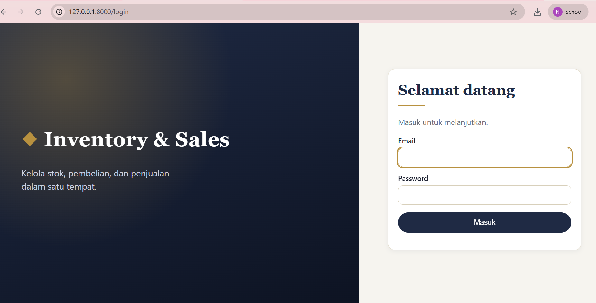 | 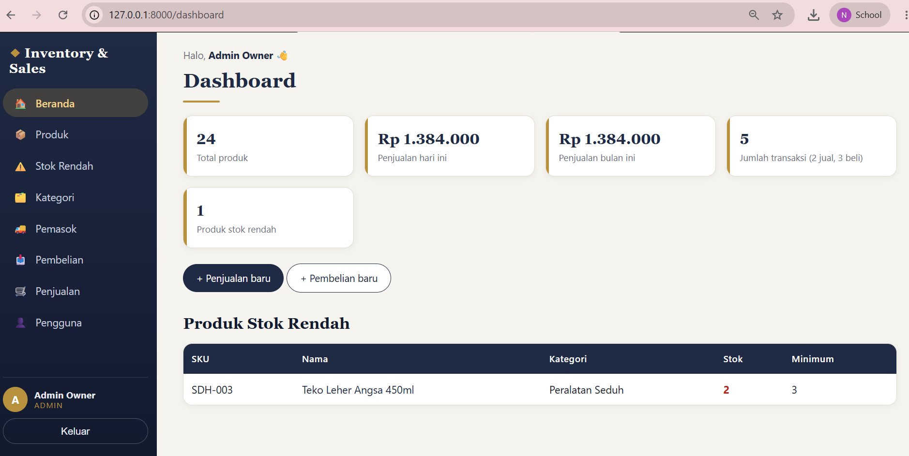 |
| **Produk (kartu, pencarian, filter kategori)** | **Penjualan dua item, total dihitung server** |
| 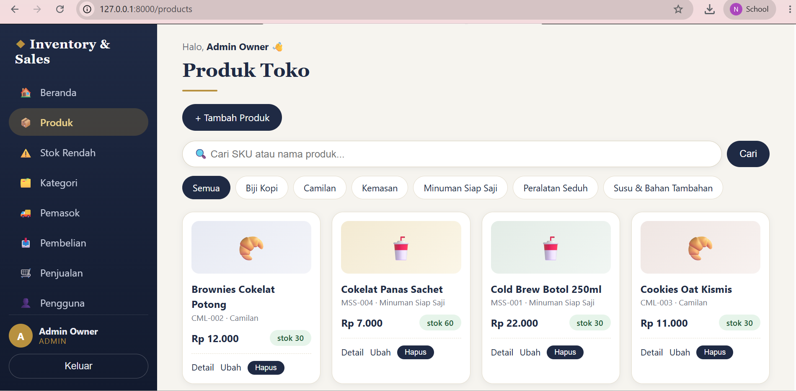 | 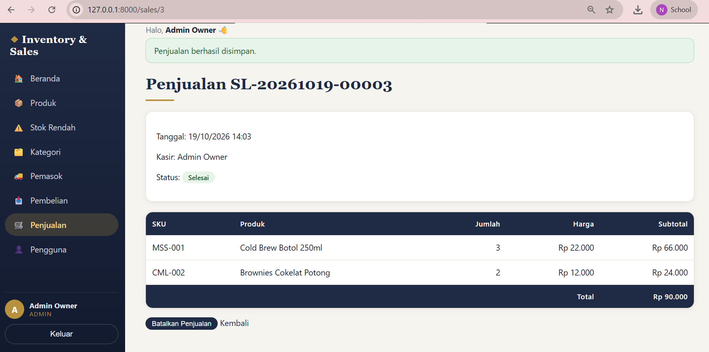 |
| **Penjualan ditolak: stok tidak cukup** | **Detail pembelian (stok bertambah)** |
| 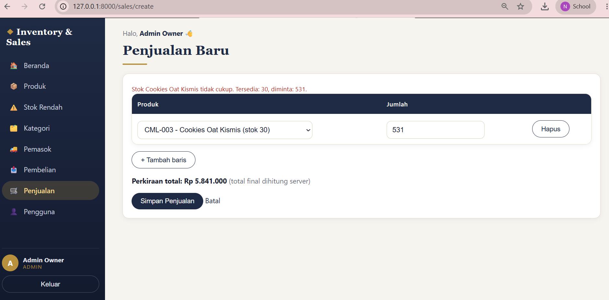 | 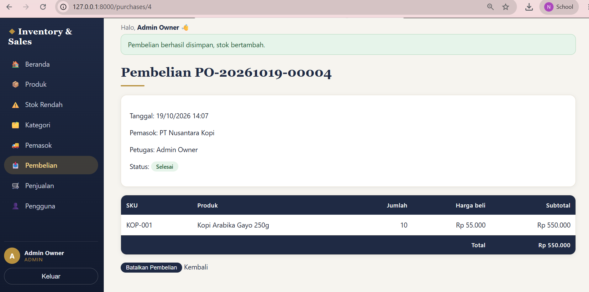 |
| **Daftar pembelian (filter, pagination)** | **Manajemen pengguna (owner)** |
| 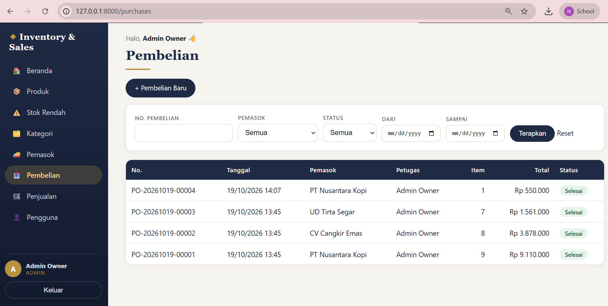 | 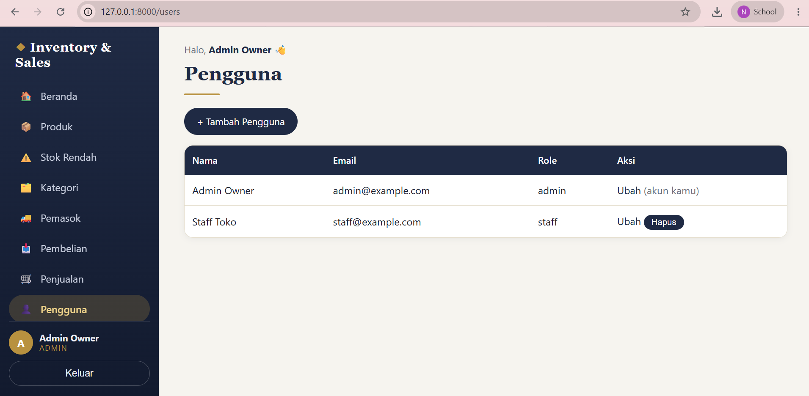 |
| **Dashboard staff (menu owner tidak tampil)** | **Staff membuka /users: 403** |
| 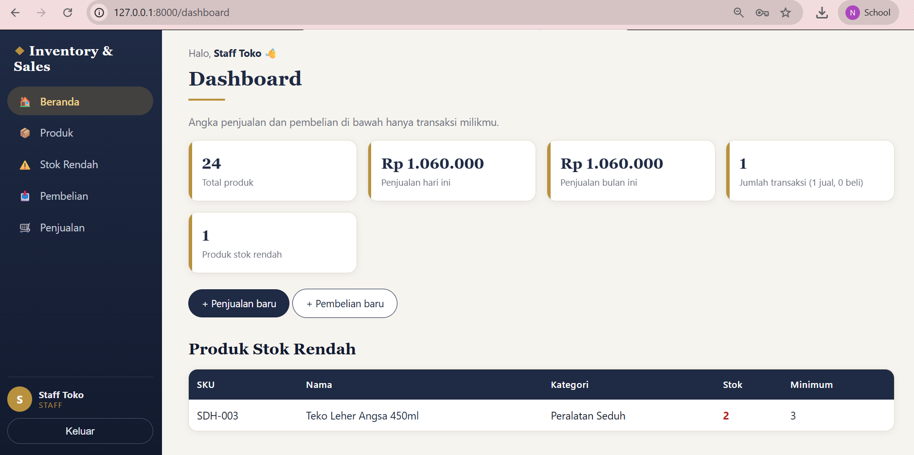 | 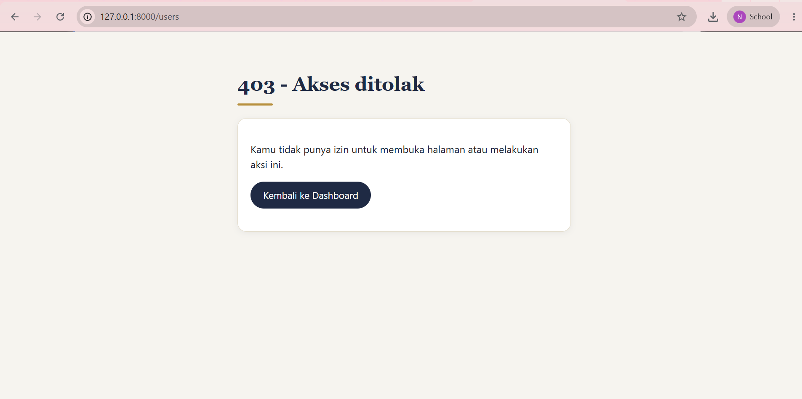 |

Bukti test otomatis: lihat [docs/test-results.txt](docs/test-results.txt).
